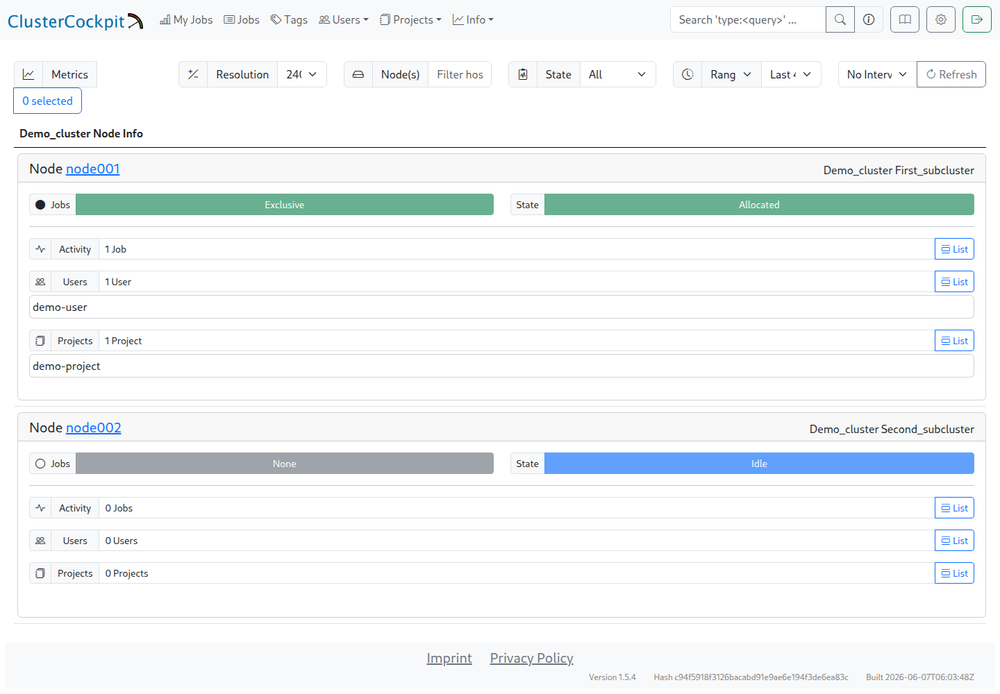

# Ersten Cluster einrichten

Die Installation legt bereits `demo_cluster`, den Subcluster `first_subcluster` und den Beispielknoten `node001` an. Diese Demowerte müssen vor dem Erfassungseinsatz zur tatsächlichen Umgebung passen. Für den ersten Test genügt ein Knoten mit der Node-Metrik `cpu_load`; eine LIKWID-Laufzeitbibliothek und Performance-Benchmarks sind dafür nicht erforderlich.

## Clustername, Hostname und Topologie

Die Clusterdefinition liegt unter `$INSTALL_DIR/cc-backend/var/job-archive/$CLUSTER_NAME/cluster.json`. Verzeichnisname, das Feld `name` und der vom Collector gesendete Clustername müssen übereinstimmen. Das Knotenmuster unter `subClusters[].nodes` muss den tatsächlich gesendeten Hostnamen erfassen. FQDN und Kurzname sind dabei nicht austauschbar.

Auf dem ersten Compute-Knoten liefern diese Befehle die Angaben zum Abgleich:

```bash
hostname
lscpu -e=CPU,CORE,SOCKET,NODE
```

`CPU` bezeichnet die logische CPU-ID. Die Arrays unter `topology` gruppieren diese IDs für den ganzen Knoten, die Sockel, NUMA-Domains und physischen Kerne. Bei SMT enthält ein Eintrag unter `core` mehrere Hardware-Thread-IDs. Angaben wie `socketsPerNode`, `coresPerSocket` und `threadsPerCore` müssen dazu passen.

## Minimales Beispiel

Das folgende vollständige Beispiel beschreibt `node001` mit einem Sockel, vier Kernen, einem Thread pro Kern und einer NUMA-Domain. Die CPU-IDs sind `0` bis `3`. Das ist ein überschaubares Beispiel für die Zuordnung, keine automatisch erkannte Hardwarekonfiguration. Für andere Knoten müssen Name, Prozessortyp, Anzahlen und Topologiearrays entsprechend angepasst werden.

Die erforderlichen Felder `flopRateScalar`, `flopRateSimd` und `memoryBandwidth` enthalten hier weiterhin die Platzhalter `1` aus der Installervorlage. Sie sind **keine gemessenen Leistungsgrenzen** und eignen sich nicht zur Leistungsbewertung oder für Roofline-Diagramme. Vor der Nutzung solcher Auswertungen sind sie durch passende Werte zu ersetzen; die [Topologie- und Leistungserfassung mit LIKWID](cluster_setup.de.md) beschreibt den automatisierten Weg.

```json
{
  "name": "demo_cluster",
  "metricConfig": [
    {
      "name": "cpu_load",
      "unit": {
        "base": ""
      },
      "scope": "node",
      "aggregation": "avg",
      "footprint": "avg",
      "timestep": 60,
      "peak": 4,
      "normal": 4,
      "caution": 1,
      "alert": 1
    }
  ],
  "subClusters": [
    {
      "name": "first_subcluster",
      "nodes": "node001",
      "processorType": "Example CPU: 4 cores",
      "socketsPerNode": 1,
      "coresPerSocket": 4,
      "threadsPerCore": 1,
      "flopRateScalar": {
        "unit": {
          "base": "F/s",
          "prefix": "G"
        },
        "value": 1
      },
      "flopRateSimd": {
        "unit": {
          "base": "F/s",
          "prefix": "G"
        },
        "value": 1
      },
      "memoryBandwidth": {
        "unit": {
          "base": "B/s",
          "prefix": "G"
        },
        "value": 1
      },
      "topology": {
        "node": [0, 1, 2, 3],
        "socket": [
          [0, 1, 2, 3]
        ],
        "memoryDomain": [
          [0, 1, 2, 3]
        ],
        "core": [
          [0],
          [1],
          [2],
          [3]
        ]
      }
    }
  ]
}
```

Die Metrik `cpu_load` ist bereits vorhanden. Ihr `timestep` von 60 Sekunden muss zum Collectorintervall passen. `peak = 4` und `normal = 4` beziehen sich hier auf das Vier-Thread-Beispiel; auch die Warn- und Alarmgrenzen sind an die gewünschte Bewertung anzupassen. Der Load Average ist dimensionslos und kein Prozentwert.

Bei einer frischen Installation kann dieses Beispiel die Demodefinition ersetzen, nachdem die Angaben angepasst wurden. In einer bestehenden Konfiguration nur die betreffenden Einträge bearbeiten; vorhandene Metriken und Subcluster bleiben erhalten. Weitere Knotentypen erhalten eigene Einträge unter `subClusters` mit passenden, eindeutigen Knotenmuster-Zuordnungen.

## Ergebnis prüfen

Auf dem Monitoringserver prüft der folgende Befehl die JSON-Syntax, ohne die Datei zu verändern. Installationspfad und Clustername müssen zur Installation passen:

```bash
INSTALL_DIR=/opt/monitoring
CLUSTER_NAME=demo_cluster
python3 -m json.tool "$INSTALL_DIR/cc-backend/var/job-archive/$CLUSTER_NAME/cluster.json" >/dev/null
```

Nach erfolgreicher Syntaxprüfung und Kontrolle der Hardwareangaben werden die Änderungen durch einen Backendneustart aktiv:

```bash
systemctl restart clustercockpit.service
systemctl status clustercockpit.service --no-pager
journalctl -u clustercockpit.service -n 50 --no-pager
```

Unter `Info → Nodes → demo_cluster → Node List` müssen die erwarteten Knoten und ihre Subcluster erscheinen. Die folgende Aufnahme zeigt synthetische Demoknoten zur Orientierung; ihre Hardwareangaben sind nicht die Vorlage für das Vier-Core-Beispiel oben.



Der Kontrollpunkt ist erreicht, wenn Clustername, Knotennamen und Subclusterzuordnung stimmen und das Backend die Konfiguration ohne Fehler lädt. Leere Metrikdiagramme sind zu diesem Zeitpunkt noch erwartbar.

Die Aufnahme enthält bereits Scheduler-Daten: `Allocated`, `Idle` und die Job-, Benutzer- und Projektzahlen. Diese Angaben kommen erst mit der Slurm-Anbindung hinzu und gehören noch nicht zu dieser Prüfung.

Vor dem nächsten Schritt müssen [HTTPS und API-Zugriff](https_setup.de.md) für die Compute-Knoten vorbereitet sein. Danach folgt die [Collectorinstallation](cc_metric_collector_setup.de.md). Die [automatische Topologieerfassung](cluster_setup.de.md) bleibt als optionaler Ausbau verfügbar.
