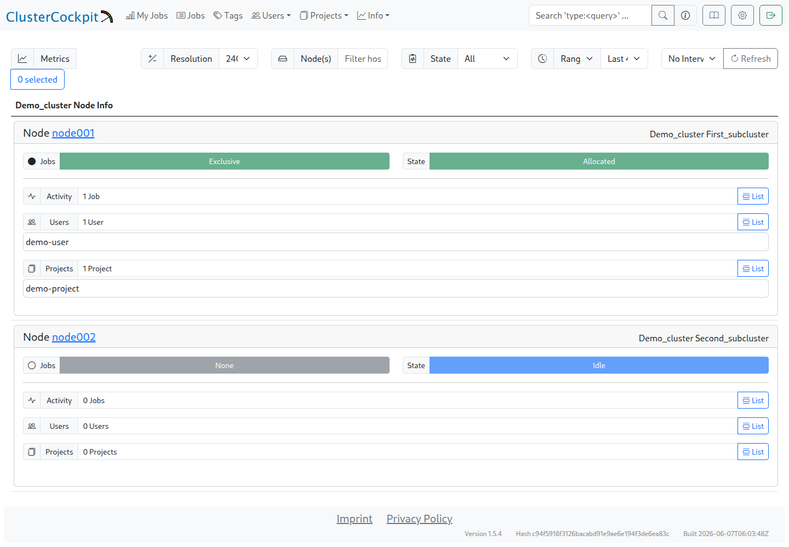

# First cluster setup

Installation already creates `demo_cluster`, subcluster `first_subcluster`, and example node `node001`. These demo values must match the actual environment before site data is collected. The first test needs only one node and the node-level metric `cpu_load`; a LIKWID runtime library and performance benchmarks are not required.

## Cluster name, hostname, and topology

The cluster definition is stored in `$INSTALL_DIR/cc-backend/var/job-archive/$CLUSTER_NAME/cluster.json`. The directory name, its `name` field, and the cluster name sent by the collector must agree. The node pattern under `subClusters[].nodes` must cover the hostname actually sent by the collector. FQDNs and short names are not interchangeable.

On the first compute node, these commands provide the values for comparison:

```bash
hostname
lscpu -e=CPU,CORE,SOCKET,NODE
```

`CPU` is the logical CPU ID. The arrays under `topology` group these IDs for the entire node, sockets, NUMA domains, and physical cores. With SMT, a `core` entry contains several hardware-thread IDs. Values such as `socketsPerNode`, `coresPerSocket`, and `threadsPerCore` must agree with those groups.

## Minimal example

The following complete example describes `node001` with one socket, four cores, one thread per core, and one NUMA domain. CPU IDs run from `0` to `3`. It is a small example of the mapping, not an automatically detected hardware configuration. Other nodes require corresponding changes to the name, processor type, counts, and topology arrays.

The required fields `flopRateScalar`, `flopRateSimd`, and `memoryBandwidth` retain the placeholder value `1` from the installation template. These are **not measured performance limits** and are unsuitable for performance assessment or roofline charts. Such analyses require appropriate values first; [LIKWID topology and performance detection](cluster_setup.md) describes the automated route.

```json
{
  "name": "demo_cluster",
  "metricConfig": [
    {
      "name": "cpu_load",
      "unit": {
        "base": ""
      },
      "scope": "node",
      "aggregation": "avg",
      "footprint": "avg",
      "timestep": 60,
      "peak": 4,
      "normal": 4,
      "caution": 1,
      "alert": 1
    }
  ],
  "subClusters": [
    {
      "name": "first_subcluster",
      "nodes": "node001",
      "processorType": "Example CPU: 4 cores",
      "socketsPerNode": 1,
      "coresPerSocket": 4,
      "threadsPerCore": 1,
      "flopRateScalar": {
        "unit": {
          "base": "F/s",
          "prefix": "G"
        },
        "value": 1
      },
      "flopRateSimd": {
        "unit": {
          "base": "F/s",
          "prefix": "G"
        },
        "value": 1
      },
      "memoryBandwidth": {
        "unit": {
          "base": "B/s",
          "prefix": "G"
        },
        "value": 1
      },
      "topology": {
        "node": [0, 1, 2, 3],
        "socket": [
          [0, 1, 2, 3]
        ],
        "memoryDomain": [
          [0, 1, 2, 3]
        ],
        "core": [
          [0],
          [1],
          [2],
          [3]
        ]
      }
    }
  ]
}
```

The metric `cpu_load` is already present. Its 60-second `timestep` must match the collector interval. Here, `peak = 4` and `normal = 4` refer to the four-thread example; warning and alert limits also need to match the intended assessment. The load average is dimensionless, not a percentage.

On a fresh installation, this example can replace the demo definition once its values have been adapted. In an existing configuration, changes belong only in the relevant entries; other metrics and subclusters remain in place. Additional node types need their own `subClusters` entries with matching, unambiguous node patterns.

## Checking the result

On the monitoring server, the following command checks JSON syntax without changing the file. The installation path and cluster name must match the installation:

```bash
INSTALL_DIR=/opt/monitoring
CLUSTER_NAME=demo_cluster
python3 -m json.tool "$INSTALL_DIR/cc-backend/var/job-archive/$CLUSTER_NAME/cluster.json" >/dev/null
```

After a successful syntax check and verification of the hardware values, a backend restart activates the changes:

```bash
systemctl restart clustercockpit.service
systemctl status clustercockpit.service --no-pager
journalctl -u clustercockpit.service -n 50 --no-pager
```

The expected nodes and their subclusters should appear under `Info → Nodes → demo_cluster → Node List`. The screenshot uses synthetic demo nodes for orientation; their hardware details are not the template for the four-core example above.



This checkpoint is complete when cluster name, node names, and subcluster assignments agree and the backend loads the configuration without errors. Empty metric plots are still expected at this stage.

The screenshot already includes scheduler data: `Allocated`, `Idle`, and the job, user, and project counts. These become available through Slurm integration and are not part of this check yet.

Before the next step, [HTTPS and API access](https_setup.md) must be prepared for the compute nodes. The next chapter is [collector installation](cc_metric_collector_setup.md). [Automatic topology detection](cluster_setup.md) remains available as an optional extension.
