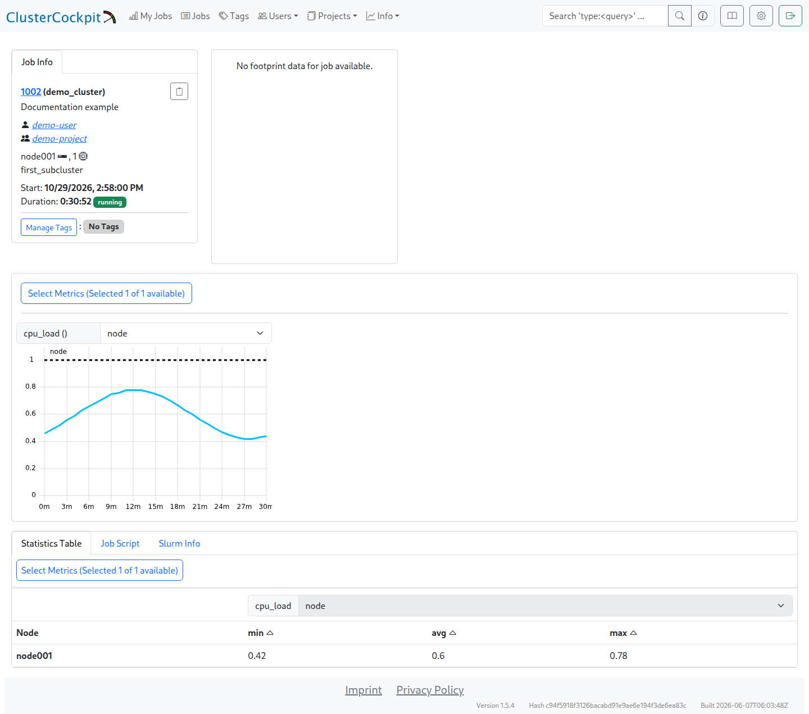
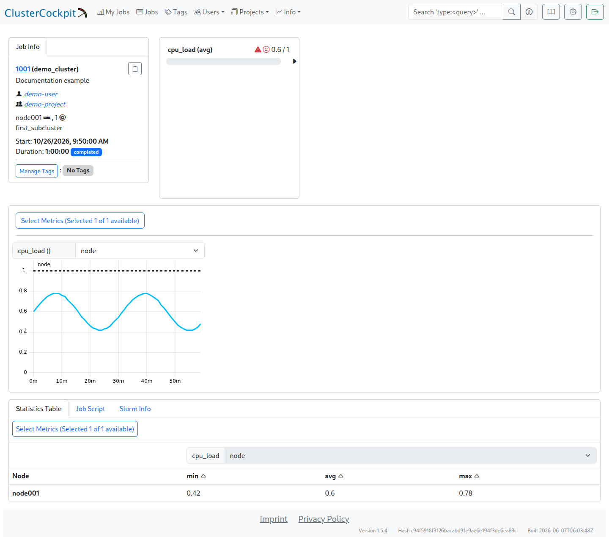

# Ersten Job prüfen

Nach der [Slurm-Anbindung](slurm_setup.de.md) lässt sich der vollständige Ablauf prüfen: Ein Job startet, seine Messwerte erscheinen in ClusterCockpit, und nach dem Ende bleiben sie im Archiv lesbar. Voraussetzung ist eine bereits sichtbare [Node-Zeitreihe](metrics.de.md).

## Testjob vorbereiten

Ein kleiner künstlicher Job auf einem eingerichteten Compute-Knoten genügt. Die Laufzeit muss die im Guide verwendete Kurzjobgrenze von 30 Sekunden überschreiten und genügend Mess- und Abfrageintervalle umfassen. Ein Job von einigen Minuten ist dafür leichter zu beurteilen als ein sehr kurzer Lauf. Partition, Account und gegebenenfalls GPU-Anforderung richten sich nach dem lokalen Slurm-Setup.

Ein einfacher Testjob kann über `sbatch` laufen. Das Beispiel verwendet die Standardpartition und den Standardaccount; erforderliche Standortoptionen kommen hinzu. Die von `sbatch` ausgegebene Slurm-Job-ID gehört zu den Vergleichsdaten. `sleep` erzeugt keine gezielte CPU-Last, lässt aber genügend Zeit für die Übertragung vorhandener Node-Messwerte.

```bash
sbatch --job-name=cc-guide-check --nodes=1 --ntasks=1 --cpus-per-task=1 \
  --time=00:05:00 --wrap='sleep 180'
```

Zu den Vergleichsdaten gehören Job-ID, Benutzer, Projekt, Knoten, CPU-/Thread-Zuordnung und gegebenenfalls GPU-PCI-Adressen. Bei Array-Jobs gehört auch die Array-ID dazu. Diese Angaben müssen zwischen Slurm und ClusterCockpit übereinstimmen.

## Laufenden Job prüfen

Die Jobliste unter `Jobs` führt zur Detailansicht. Während des Laufs müssen die erwarteten Ressourcen erscheinen und die Messkurven neue Werte erhalten. Ein vorhandener Jobeintrag ohne passende Messwerte reicht als Prüfung nicht aus.



Die Aufnahme zeigt den laufenden Demo-Job `1002` im Cluster `demo_cluster` auf `node001`. Die Daten sind künstlich. Die spätere Archivaufnahme zeigt einen anderen Demo-Job (`1001`); beide Bilder veranschaulichen die jeweiligen Zustände. Bei einer realen Prüfung folgt der gesamte Ablauf derselben Job-ID.

Fehlt der Job, liegt die erste Prüfung bei der Scheduleranbindung. Ist der Job vorhanden, fehlen aber Messwerte, folgt die Prüfung von Collector, Write-API und Ressourcenidentitäten. Die [Fehlersuche](faq.de.md) beschreibt diese beiden Wege getrennt.

## Einen abgeschlossenen Job prüfen

Nach Jobende braucht der Adapter Zeit für die nächste Abfrage. Die Prüfung folgt nach mindestens einem vollständigen Abfrageintervall.

Über `Jobs` die Job-ID öffnen und die Zeitreihe sowie die `Statistics Table` prüfen. Die folgende Aufnahme zeigt Job `1001` im Cluster `demo_cluster`, Knoten `node001`, mit einer Laufzeit von einer Stunde und dem Zustand `completed`.



Die Werte sind künstliche Demodaten. Die Statistiktabelle enthält `min = 0,42`, `avg = 0,60` und `max = 0,78`; dieselbe Schwankung ist in der Kurve erkennbar. Das Warnsymbol bei `cpu_load(avg)` gehört zur Schwellwertbewertung: Der Mittelwert 0,60 liegt unter der hier gewählten Grenze `alert = 1`.

Der Slurm-Zustand `completed` und ein sichtbarer Graph belegen für sich genommen noch keine dauerhafte Archivierung. Dafür muss der Backend-Monitoringstatus `3` (archiviert) erreicht sein. Zusätzlich gehören bekannte Werte und Identitäten zum Vergleich.

[Jobansicht in Originalgröße](img/archived_job.png).

## Archivstatus über die API prüfen

Die interne Backend-ID steht in der URL der geöffneten Jobansicht, etwa `/monitoring/job/42`. Sie ist nicht die Slurm-Job-ID. Der API-Endpunkt `/api/jobs/42?all-metrics=true` verwendet diese interne ID; die Antwort enthält die Slurm-Job-ID unter `Meta.jobId` und den Archivstatus unter `Meta.monitoringStatus`.

Das folgende Beispiel läuft auf dem Monitoring-Server unter einem Konto mit Leserecht auf die geschützte Token-Datei. Hostname, interne ID `42` und Slurm-Job-ID `12345` stehen für die tatsächlichen Werte. Der Token wird aus der Datei gelesen und erscheint nicht in Prozessargumenten. Die HTTPS-Prüfung bleibt aktiv.

```bash
python3 - https://monitoring.example.org 42 12345 <<'PYTHON'
import json
import sys
import urllib.request
from pathlib import Path

base, backend_id, slurm_id = sys.argv[1:]
token = Path('/opt/monitoring/cc-backend/apikey.txt').read_text().strip()
request = urllib.request.Request(
    base.rstrip('/') + '/api/jobs/' + str(int(backend_id)) + '?all-metrics=true',
    headers={'X-Auth-Token': token},
)
with urllib.request.urlopen(request, timeout=30) as response:
    job = json.load(response)
meta = job['Meta']
if meta['jobId'] != int(slurm_id):
    raise SystemExit('The response belongs to a different Slurm job')
print('cluster:', meta['cluster'])
print('jobId:', meta['jobId'])
print('monitoringStatus:', meta['monitoringStatus'])
if meta['monitoringStatus'] != 3:
    raise SystemExit('The job has not been archived yet')
PYTHON
```

Die Ausgabe muss den erwarteten Cluster, die richtige Slurm-Job-ID und `monitoringStatus: 3` zeigen. Eine abweichende Job-ID oder ein anderer Status beendet die Prüfung mit einem Fehler. Ein noch laufender Archivierungsprozess benötigt zunächst Zeit; bei dauerhaft fehlendem Status 3 helfen Backendjournal und Scheduler-Accounting.

## Archiv nach einem Neustart prüfen

Ein kontrollierter Backend-Neustart und ein erneuter Abruf desselben Jobs prüfen, ob das Archiv unabhängig vom laufenden Metric-Store lesbar ist. In einer genutzten Installation setzt das den [Wartungsablauf](backup_restore.de.md#dienste-anhalten) voraus. Danach müssen Job-ID, Ressourcen, bekannte Zeitreihen und ihre Werte weiterhin übereinstimmen.

Erst diese Prüfung verbindet Jobstart, laufende Messwerte, Jobende und dauerhaft lesbare Daten zu einem vollständigen Test. Die [Persistenzgrenzen](operation.de.md#persistenzgrenzen-des-integrierten-stores) des integrierten Stores bleiben dabei relevant.
