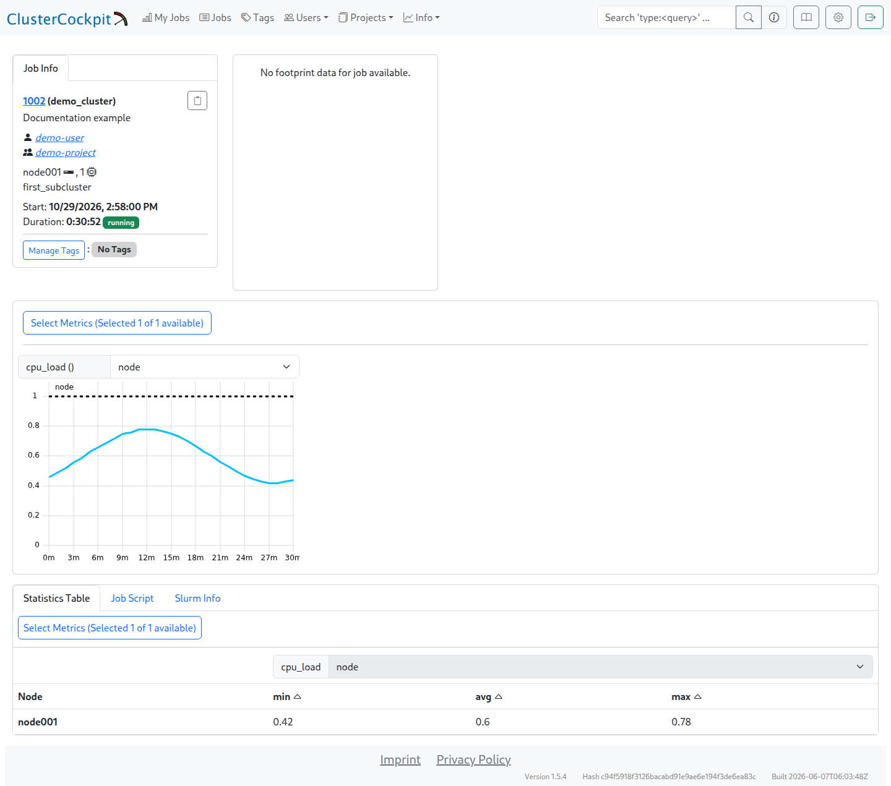
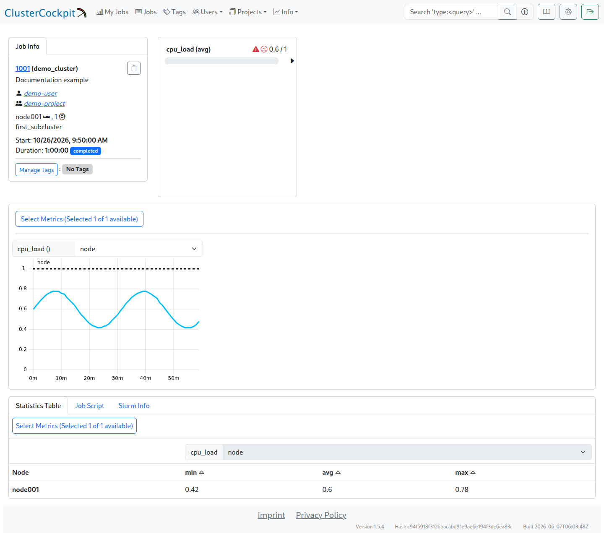

# Check the first job

Once [Slurm integration](slurm_setup.md) is in place, the complete workflow can be checked: a job starts, its measurements appear in ClusterCockpit, and those measurements remain readable from the archive after completion. A visible [node time series](metrics.md) is a prerequisite.

## Prepare a test job

A small synthetic job on a configured compute node is sufficient. Its runtime must exceed the guide's 30-second short-job threshold and cover enough measurement and polling intervals. A run of several minutes is easier to assess than a very short job. Partition, account, and any GPU request depend on the local Slurm setup.

A simple test job can run through `sbatch`. This example uses the default partition and account; site-specific options may be required. The Slurm job ID printed by `sbatch` is part of the comparison. `sleep` does not generate deliberate CPU load, but allows enough time to transfer the available node measurements.

```bash
sbatch --job-name=cc-guide-check --nodes=1 --ntasks=1 --cpus-per-task=1 \
  --time=00:05:00 --wrap='sleep 180'
```

The comparison includes job ID, user, project, nodes, CPU/thread allocation, and GPU PCI addresses where applicable. Array jobs also need the array ID. These values must agree between Slurm and ClusterCockpit.

## Check the running job

The list under `Jobs` leads to the job detail view. During execution, the expected resources must appear and the charts must receive new measurements. A job entry without corresponding measurements is not a complete check.



The screenshot shows running demo job `1002` in `demo_cluster` on `node001`. Its data is synthetic. The archive screenshot below shows a different demo job (`1001`); the two images illustrate the respective states. An actual acceptance check follows the same job ID throughout.

A missing job points first to scheduler integration. A visible job with missing measurements calls for checks of the collector, write API, and resource identities. [Troubleshooting](faq.md) separates these two paths.

## Check a completed job

After completion, the adapter needs time for its next query. Verification follows after at least one full polling interval.

The job ID under `Jobs` opens the time series and `Statistics Table`. The screenshot below shows job `1001` in `demo_cluster` on `node001`, with a one-hour runtime and state `completed`.



The values are synthetic. The statistics table contains `min = 0.42`, `avg = 0.60`, and `max = 0.78`; the same variation is visible in the curve. The warning icon next to `cpu_load(avg)` comes from threshold evaluation: the average of 0.60 is below the example's `alert = 1` threshold.

Slurm state `completed` and a visible chart do not by themselves prove durable archival. The backend monitoring status must also reach `3` (archived), and known values and identities must match.

[Full-size job view](img/archived_job.png).

## Check archive status through the API

The internal backend ID appears in the open job view's URL, such as `/monitoring/job/42`. It is not the Slurm job ID. The API endpoint `/api/jobs/42?all-metrics=true` uses this internal ID; its response contains the Slurm job ID as `Meta.jobId` and archive status as `Meta.monitoringStatus`.

This example runs on the monitoring server under an account with read access to the protected token file. The hostname, internal ID `42`, and Slurm job ID `12345` stand for the actual values. The token is read from its file and does not appear in process arguments. HTTPS verification remains enabled.

```bash
python3 - https://monitoring.example.org 42 12345 <<'PYTHON'
import json
import sys
import urllib.request
from pathlib import Path

base, backend_id, slurm_id = sys.argv[1:]
token = Path('/opt/monitoring/cc-backend/apikey.txt').read_text().strip()
request = urllib.request.Request(
    base.rstrip('/') + '/api/jobs/' + str(int(backend_id)) + '?all-metrics=true',
    headers={'X-Auth-Token': token},
)
with urllib.request.urlopen(request, timeout=30) as response:
    job = json.load(response)
meta = job['Meta']
if meta['jobId'] != int(slurm_id):
    raise SystemExit('The response belongs to a different Slurm job')
print('cluster:', meta['cluster'])
print('jobId:', meta['jobId'])
print('monitoringStatus:', meta['monitoringStatus'])
if meta['monitoringStatus'] != 3:
    raise SystemExit('The job has not been archived yet')
PYTHON
```

The output must show the expected cluster, the correct Slurm job ID, and `monitoringStatus: 3`. A different job ID or status ends the check with an error. Archival still in progress needs time; a persistent absence of status 3 calls for checks of the backend journal and scheduler accounting.

## Check the archive after a restart

A controlled backend restart followed by another request for the same job checks that the archive is readable independently of the running metric store. An installation in use needs the [maintenance procedure](backup_restore.md#stop-the-services) first. Job ID, resources, known time series, and their values must still agree afterwards.

This completes the check from job start and live measurements through completion to persistently readable data. The integrated store's [persistence limits](operation.md#integrated-store-persistence-limits) still apply.
