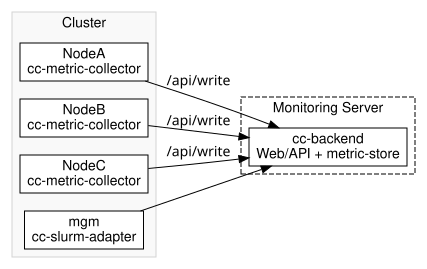

# Einführung

Dieser Guide beschreibt die Einrichtung von ClusterCockpit für HPC-Cluster: von der Vorbereitung der Systeme über die ersten Messwerte bis zum laufenden Betrieb.

Der Guide ist im Projekt [HPC.NRW](https://hpc.dh.nrw) entstanden. Die Beispiele stammen von der [FAU Erlangen](https://github.com/ClusterCockpit/cc-examples/tree/main/nhr%40fau) und der Ruhr-Universität Bochum. Wir halten die Anleitung nach Möglichkeit aktuell. Probleme, Fehler und Verbesserungsvorschläge können als [Issue im GitHub-Repository](https://github.com/hpc-nrw/cc-setup-guide/issues) gemeldet werden.

## Was ist ClusterCockpit?

ClusterCockpit zeigt, wie einzelne Jobs die Ressourcen eines HPC-Clusters nutzen. Dazu verbindet es Jobdaten mit Leistungs- und Energiemesswerten sowie weiteren Statistiken. So können Administratoren und Nutzende die Auslastung, Effizienz und den Zustand des Clusters beurteilen.

Die Software wird an der [Friedrich-Alexander-Universität Erlangen-Nürnberg (FAU)](https://www.fau.de/) entwickelt und ist Open Source. Demos, Downloads und die offizielle Dokumentation stehen auf [clustercockpit.org](https://clustercockpit.org) bereit.

Zu den Messwerten gehören auch hardwarenahe Größen wie FLOPS und Speicherbandbreite. Dafür kommt neben anderen Metrikkollektoren [LIKWID](https://github.com/RRZE-HPC/likwid) zum Einsatz. LIKWID wird ebenfalls maßgeblich an der FAU entwickelt und bietet Werkzeuge, mit denen sich die Leistung der Hardware lokal analysieren und durch Benchmarks messen lässt.

## Komponenten von ClusterCockpit

Die Arbeit teilen sich drei Komponenten, die auf unterschiedlichen Systemen laufen und Daten miteinander austauschen:

- **cc-backend** stellt die Weboberfläche und die API bereit. Es verwaltet Benutzer und Konfiguration, bindet die Datenbank an und hält Messwerte vorübergehend als Zeitreihen im integrierten Metric-Store vor.
- **cc-metric-collector** läuft auf den Compute-Knoten. Er erfasst unter anderem CPU-Last, Speicher-, Netzwerk- und I/O-Metriken und schickt sie an die Write-API von `cc-backend`.
- **cc-slurm-adapter** verbindet SLURM mit ClusterCockpit. Er liefert die Jobdaten, etwa Benutzer, Projekt und zugewiesene Ressourcen, damit sie in ClusterCockpit angezeigt werden können.

## Typischer Aufbau

In einer üblichen Installation läuft `cc-backend` auf einem eigenen Monitoring-Server. Auf jedem Compute-Knoten arbeitet ein `cc-metric-collector`; auf dem SLURM-Management-Knoten kommt der `cc-slurm-adapter` hinzu.

Im Diagramm schicken die Collectoren auf `NodeA`, `NodeB` und `NodeC` ihre Messwerte über `/api/write` an das Backend. Vom Management-Knoten kommen die Jobdaten des Slurm-Adapters dazu. Das Backend stellt die Weboberfläche, die API und den integrierten Metric-Store bereit.

## Was kann ClusterCockpit erfassen?

Welche Messwerte verfügbar sind, hängt von der Hardware und der Konfiguration ab. ClusterCockpit ist modular aufgebaut und unterstützt unter anderem:

- CPU-Last und Auslastung
- Speicherauslastung
- Netzwerk- und Dateisystemleistung
- FLOPS und Speicherbandbreite über [LIKWID](https://github.com/RRZE-HPC/likwid)
- GPU- und InfiniBand-Metriken
- eigene Metriken

## Zielgruppe dieser Anleitung

Der Guide richtet sich an Systemadministratoren, die ClusterCockpit in ihrer eigenen HPC-Umgebung installieren, konfigurieren und betreiben möchten. Er setzt Grundkenntnisse in Linux-Administration und Cluster-Architektur voraus, insbesondere in SLURM und den Aufgaben von Management- und Compute-Knoten. Für die Installation ist außerdem SSH-Zugang zu den Zielsystemen nötig.

## Wie ist diese Dokumentation aufgebaut?

Für eine neue Installation führt der folgende Weg bis zum ersten archivierten Job. Die Beispiele verwenden durchgehend `demo_cluster` und `node001`; in einer eigenen Installation müssen Cluster- und Knotennamen zusammenpassen.

| Etappe | Ergebnis |
|---|---|
| [Systeme vorbereiten](system_preparation.de.md) | Rollen, Versionen, Zugänge und Netzwerkverbindungen sind geklärt. |
| [Backend installieren](monitoringserver.de.md) und [Login prüfen](webinterface.de.md) | Die Weboberfläche ist erreichbar. |
| [Ersten Knoten eintragen](cluster_minimal.de.md) und [HTTPS/API vorbereiten](https_setup.de.md) | Knotenidentität und erreichbarer, geschützter API-Endpunkt stehen fest. |
| [Collector installieren](cc_metric_collector_setup.de.md) | Binary und Basisdateien liegen auf dem Compute-Knoten. |
| [Schnellstart](cc_metric_collector_quicksetup.de.md) **oder** [erste Metrik im Detail](metrics.de.md) | `cpu_load` kommt mit dem richtigen Cluster- und Knotennamen an. |
| [Collector dauerhaft starten](collector_service.de.md) | Die Node-Ansicht zeigt eine Zeitreihe über mehrere Messintervalle. |
| [Slurm anbinden](slurm_setup.de.md) und [Testjob prüfen](first_job.de.md) | Ein Job erscheint während seiner Laufzeit und bleibt nach Abschluss mit seinen Messwerten im Archiv lesbar. |

Der [Weg eines Messwerts](metric_flow.de.md) erklärt das Zusammenspiel der Konfigurationsdateien. Danach lassen sich [weitere Metriken](more_metrics.de.md) und [LIKWID-Metriken](likwid_metrics.de.md) gezielt ergänzen. Nicht jeder Cluster benötigt alle Collectoren.

Für bestehende Installationen sind [Updates und Migration](updates.de.md), [Backup und Wiederherstellung](backup_restore.de.md) sowie die [Fehlersuche](faq.de.md) eigene Einstiege. Vollständige [Standortbeispiele](example_profiles.de.md) und die [Einheitenreferenz](units.de.md) dienen zum Nachschlagen.
