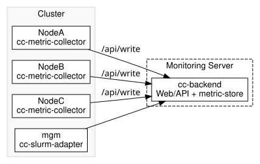

# Introduction

This guide explains how to set up ClusterCockpit on an HPC cluster, from server preparation and the first measurements to day-to-day operation.

This guide was written as part of the [HPC.NRW](https://hpc.dh.nrw) project. It uses example configurations from [FAU Erlangen](https://github.com/ClusterCockpit/cc-examples/tree/main/nhr%40fau) and Ruhr University Bochum.

The guide is maintained as time allows. Reports of problems, corrections, and suggestions are welcome as [issues in the GitHub repository](https://github.com/hpc-nrw/cc-setup-guide/issues).

## What is ClusterCockpit?

ClusterCockpit is an open-source tool for monitoring HPC clusters and analysing individual jobs. It brings together job data, performance and energy metrics, and other statistics. This helps administrators and users assess cluster utilisation, efficiency, and the health of cluster resources.

ClusterCockpit is developed at [Friedrich-Alexander University Erlangen-Nuremberg (FAU)](https://www.fau.de/). The [project website](https://clustercockpit.org) provides demos, downloads, documentation, and further resources.

Hardware metrics such as FLOPS and memory bandwidth are an important part of the monitoring setup. ClusterCockpit uses [LIKWID](https://github.com/RRZE-HPC/likwid), alongside other metric collectors, to gather these measurements. LIKWID is developed primarily at FAU and also provides tools for analysing and benchmarking hardware performance locally.

## ClusterCockpit components

The components run on different systems in the cluster and exchange job data and measurements:

- **cc-backend** provides the web interface, API, database access, and integrated metric store. It also handles user management, configuration, and temporary storage of time-series data.
- **cc-metric-collector** runs on the compute nodes. It collects measurements such as CPU load, memory usage, network traffic, and I/O, then sends them to the `cc-backend` write API.
- **cc-slurm-adapter** connects SLURM to ClusterCockpit. It supplies job metadata, including users, projects, and allocations.

## Typical setup

In a typical installation, `cc-backend` runs on a dedicated monitoring server. Each compute node runs `cc-metric-collector`, and `cc-slurm-adapter` runs on the SLURM management node.

In this diagram, the collectors on `NodeA`, `NodeB`, and `NodeC` send their measurements to `cc-backend` through `/api/write`. The Slurm adapter on the management node supplies the job data. The backend provides the web interface, API, and integrated metric store.

## What can ClusterCockpit monitor?

ClusterCockpit is modular. The available metrics depend on the hardware and configuration and include:

- CPU load and utilisation
- Memory usage
- Network and filesystem performance
- FLOPS and memory bandwidth, collected with [LIKWID](https://github.com/RRZE-HPC/likwid)
- GPU and InfiniBand metrics
- Custom metrics

## Who is this guide for?

This guide is for system administrators who want to install, configure, and run ClusterCockpit in their own HPC environment.

The setup requires basic Linux administration skills and SSH access to the target systems. The guide also assumes familiarity with SLURM and the roles of management and compute nodes.

## How is this guide structured?

For a new installation, the following path leads to the first archived job. The examples consistently use `demo_cluster` and `node001`; cluster and node names must agree throughout an actual installation.

| Stage | Result |
|---|---|
| [Prepare the systems](system_preparation.md) | Roles, versions, access, and network connections are clear. |
| [Install the backend](monitoringserver.md) and [check the login](webinterface.md) | The web interface is reachable. |
| [Define the first node](cluster_minimal.md) and [prepare HTTPS/API access](https_setup.md) | The node identity and a reachable, protected API endpoint are in place. |
| [Install the collector](cc_metric_collector_setup.md) | The compute node has the binary and basic configuration files. |
| [Quick setup](cc_metric_collector_quicksetup.md) **or** [the first metric in detail](metrics.md) | `cpu_load` arrives with the correct cluster and node names. |
| [Run the collector as a service](collector_service.md) | The node view shows a time series covering several collection intervals. |
| [Connect Slurm](slurm_setup.md) and [check a test job](first_job.md) | A job appears while running and remains readable with its measurements after archival. |

[The path of a metric](metric_flow.md) explains how the configuration files work together. [Additional metrics](more_metrics.md) and [LIKWID metrics](likwid_metrics.md) can then be added as needed. Not every cluster needs every collector.

For existing installations, [updates and migration](updates.md), [backup and recovery](backup_restore.md), and [troubleshooting](faq.md) provide separate starting points. Complete [site examples](example_profiles.md) and the [units reference](units.md) cover configuration details.
