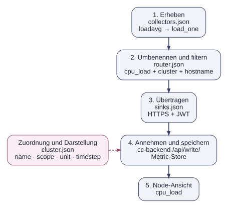

# Der Weg eines Messwerts

Für die erste Metrik arbeiten Collector und Backend mit mehreren Konfigurationsdateien zusammen. Das Beispiel `cpu_load` zeigt, welche Datei welchen Teil übernimmt.

## Dateien und Aufgaben

Die Collector-Dateien liegen gemeinsam im Collector-Arbeitsverzeichnis, im Guide unter `/cluster/monitoring/cc-metric-collector`. Die Backend-Clusterdefinition liegt dagegen unter `$INSTALL_DIR/cc-backend/var/job-archive/$CLUSTER_NAME/cluster.json`.

| Datei | Aufgabe im Beispiel |
|---|---|
| `config.json` | Verknüpft die Collector-Dateien und setzt das Messintervall. |
| `collectors.json` | Aktiviert `loadavg`, das unter anderem `load_one` liefert. |
| `router.json` | Benennt `load_one` in `cpu_load` um, ergänzt die Clusterkennung und filtert unerwünschte Messwerte. Bei anderen Metriken finden hier auch Einheitenumrechnungen statt. |
| `sinks.json` | Enthält den HTTPS-Endpunkt und den rohen Backend-JWT für die Übertragung. |
| `cluster.json` | Ordnet Hostnamen der Topologie zu und definiert die Metrik mit Name, Scope, Einheit, Aggregation und Anzeigeintervall. |

`config_stdout.json` verweist auf einen stdout-Sink. Damit lässt sich der Wert nach dem Routing im Terminal prüfen, bevor eine HTTP-Übertragung erfolgt. Die Unterscheidung zwischen diesen beiden Testwegen ist in der [ersten Metrik](metrics.de.md) beschrieben.

## Was zusammenpassen muss

- **Identität:** Der `cluster`-Tag muss zum Backendcluster passen. Der `hostname`-Tag muss einen Knoten aus dessen Topologie bezeichnen. Bei feineren Scopes müssen auch die IDs der Hardwareeinheiten übereinstimmen.
- **Name:** Nach der Umbenennung heißt die Metrik `cpu_load`. Filter und Backenddefinition verwenden diesen Namen, nicht mehr `load_one`.
- **Einheit:** Der Router liefert den bereits skalierten Zahlenwert. Ein Einheitenlabel in `cluster.json` rechnet ihn nicht nochmals um. `cpu_load` ist dimensionslos und kein Prozentwert.
- **Zeit:** `main.interval` und `timestep` müssen zusammenpassen. Differenzwerte und daraus abgeleitete Raten benötigen mehrere Messungen; `-once` liefert diese Werte nicht.

Der integrierte Metric-Store hält die laufenden Zeitreihen. Seine Laufzeit- und Aufbewahrungseinstellungen stehen in `cc-backend/config.json` unter `metric-store`. Das Jobarchiv enthält die Messwerte abgeschlossener Jobs. [Speicherung und Anzeige](metric_receive_display.de.md) erläutert diese Aufgaben und die Grenzen bei Neustarts.

## Von der Node-Ansicht zum Job

Eine gefüllte Node-Zeitreihe bestätigt, dass die Messwerte ankommen. Für eine Jobansicht kommen die Jobzeiten und die belegten Ressourcen aus der [Slurm-Anbindung](slurm_setup.de.md) hinzu. Erst damit kann das Backend die Messwerte einem Job zuordnen. Der [Testjob](first_job.de.md) prüft diesen vollständigen Ablauf bis zur Archivierung.
