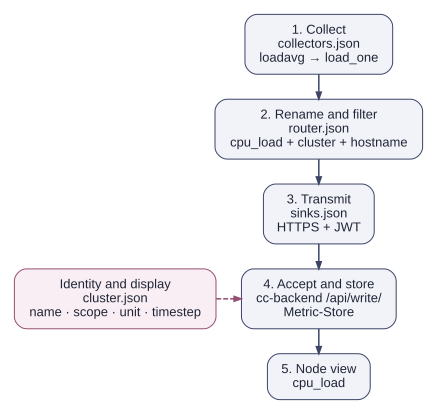

# The path of a metric

The first metric involves several configuration files on the collector and backend. The `cpu_load` example shows the role of each file.

## Files and responsibilities

The collector files share its working directory, `/cluster/monitoring/cc-metric-collector` in this guide. The backend's cluster definition lives separately at `$INSTALL_DIR/cc-backend/var/job-archive/$CLUSTER_NAME/cluster.json`.

| File | Role in this example |
|---|---|
| `config.json` | Connects the collector files and sets the collection interval. |
| `collectors.json` | Enables `loadavg`, which produces `load_one` among other values. |
| `router.json` | Renames `load_one` to `cpu_load`, adds the cluster identity, and filters unwanted measurements. Other metrics may also need unit conversions here. |
| `sinks.json` | Contains the HTTPS endpoint and raw backend JWT for transmission. |
| `cluster.json` | Maps hostnames to the topology and defines the metric's name, scope, unit, aggregation, and display interval. |

`config_stdout.json` refers to a stdout sink. It exposes the value after routing in the terminal before any HTTP transmission. [The first metric](metrics.md) explains these two test paths.

## Values that must agree

- **Identity:** The `cluster` tag must match the backend cluster. The `hostname` tag must identify a node in its topology. Finer scopes also require matching hardware-unit IDs.
- **Name:** After renaming, the metric is called `cpu_load`. Filters and the backend definition use this name, rather than `load_one`.
- **Unit:** The router supplies the already scaled numeric value. A unit label in `cluster.json` does not convert it again. `cpu_load` is dimensionless, not a percentage.
- **Time:** `main.interval` and `timestep` must agree. Counter differences and rates derived from them need several measurements; `-once` does not produce these values.

The integrated metric store holds live time series. Its runtime and retention settings live under `metric-store` in `cc-backend/config.json`. The job archive contains measurements for completed jobs. [Storage and display](metric_receive_display.md) explains these roles and their restart limitations.

## From node measurements to a job

A populated node time series confirms that measurements are arriving. A job view also needs the job's times and allocated resources from the [Slurm integration](slurm_setup.md). These allow the backend to associate the measurements with the job. [The test job](first_job.md) checks this complete path through to archival.
