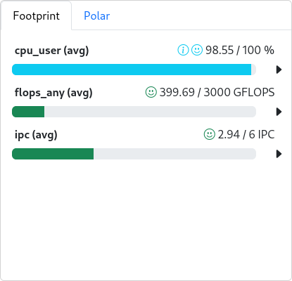
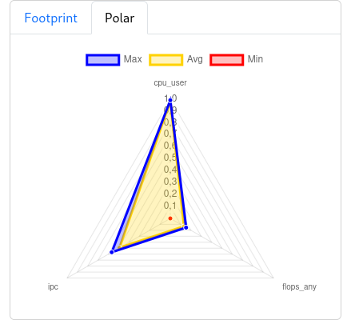

# Metriken empfangen und anzeigen

Eine neue Metrik braucht neben der Collector-Konfiguration einen Eintrag in `metricConfig` in der `cluster.json`. Erst dann kann `cc-backend` die Werte annehmen und anzeigen. Der [Weg eines Messwerts](metric_flow.de.md) zeigt, wie Collector, Router, Write-API und Backend zusammenarbeiten.

Für den ersten Empfang genügt die vorhandene Store-Konfiguration aus der Installation. Der direkte Weg führt über den Metrikeintrag und den Neustart zur Prüfung in der Node-Ansicht. Anzeigeoptionen und Store-Aufbewahrung folgen weiter unten.

<a id="2-cc-backend-clusterjson-aktualisieren"></a>

## 1. Metrik in cluster.json eintragen

Dateipfad:  
`$INSTALL_DIR/cc-backend/var/job-archive/$CLUSTER_NAME/cluster.json`

`cluster.json` beschreibt die Subcluster und die verfügbaren Metriken. Jede Metrik erhält ein eigenes Objekt im Array `metricConfig`.

### Minimaler Eintrag

```json
{
  "name": "cpu_load",
  "unit": { "base": "" },
  "scope": "node",
  "aggregation": "avg",
  "timestep": 60,
  "peak": 48,
  "normal": 48,
  "caution": 10,
  "alert": 1
}
```

**Wichtige Felder:**
- `name`: Der Name muss exakt zum veröffentlichten Namen nach dem Routing passen, etwa nach `rename_messages`.
- `unit`: Basiseinheit und optional ein Präfix wie `"M"` oder `"G"`. Beide müssen zu den bereits skalierten Werten aus `router.json` passen.
- `scope`: Hardwareebene der Messung: `node`, `socket`, `hwthread`, `memoryDomain` oder `accelerator`.
- `aggregation`: Üblicherweise `avg` für Zustandswerte und `sum` für Werte, die sich über Hardwareeinheiten addieren lassen.
- `timestep`: Anzeigeintervall in Sekunden, passend zu `main.interval` des Collectors.
- `peak`, `normal`, `caution`, `alert`: Referenz- und Schwellenwerte der Anzeige. Zwischen `normal` und `caution` bleibt der Graph neutral, zwischen `caution` und `alert` wird er gelb, unterhalb von `alert` rot. Entscheidend für die Bewertung sind der konkrete Messwert und die dazu konfigurierten Grenzen.

<a id="anderungen-aktivieren"></a>

## 2. Änderungen aktivieren und Empfang prüfen

Ein Neustart von `cc-backend` auf dem Monitoring-Server aktiviert die geänderte Metrikkonfiguration:
```bash
systemctl restart clustercockpit.service
```


<a id="3-prufen-ob-metriken-ankommen"></a>

Nach mehreren Messintervallen sollten die Node-Graphen der aktiven Collectoren Werte zeigen. Der Vergleich umfasst den Metriknamen, Cluster, Hostname, Scope und das Messintervall. Die stdout-Ausgabe muss zur Zeitreihe und zu den angezeigten Zahlen passen.
Der Hinweis `Missing Metric` mit dem Text `No dataset returned for …` bedeutet, dass für die genannte Metrik kein Datensatz zurückgegeben wurde. Die Abbildung zeigt dies für `job_mem_used`:


Bei fehlenden Werten führt der Prüfweg vom veröffentlichten Namen in der Collector-Ausgabe zum Eingang an `/api/write/` und zum Eintrag in `metricConfig`. Die [Fehlerdiagnose](faq.de.md) beschreibt die nächsten Prüfungen.

### Einen abgeschlossenen Job prüfen

Eine gefüllte Node-Zeitreihe bestätigt den Empfang von Messwerten. Die Zuordnung zu Jobs und deren Archivierung prüft anschließend [Ein erster vollständiger Job](first_job.de.md), sobald die Slurm-Anbindung eingerichtet ist. Dort stehen Testablauf, erwarteter Monitoringstatus, Neustartprüfung und die archivierte Demo-Jobansicht.

<a id="konfigurationsmoglichkeiten"></a>

## Optionale Anzeigeeinstellungen

### Alert-Logik umkehren
`"lowerIsBetter": true` kehrt die Bewertung um: Hohe Werte lösen dann den Hinweis aus. Das kommt etwa für `cpu_load_core`, Netzwerkbandbreiten infrage.

### Metrik nur für bestimmte Subcluster
Einzelne Subcluster können Metriken aus der gemeinsamen Konfiguration entfernen. So bleiben GPU-Metriken auf Subcluster mit GPUs beschränkt:

```json
{
  "name": "acc_mem_used",
  "unit": { "base": "B", "prefix": "G" },
  "lowerIsBetter": true,
  "scope": "accelerator",
  "aggregation": "sum",
  "timestep": 60,
  "peak": 100,
  "normal": 50,
  "caution": 80,
  "alert": 90,
  "subClusters": [
    { "name": "cpu", "remove": true },
    { "name": "cpu_abs2", "remove": true },
    { "name": "fatcpu", "remove": true },
    { "name": "tcpu", "remove": true }
  ]
}
```

Eine entfernte Metrik erscheint im betroffenen Subcluster weder in der Jobansicht noch in der Metrikauswahl. In der Node-Ansicht für Administratoren steht stattdessen `Metric disabled for subcluster` mit Metrik- und Subclustername. Die Abbildung zeigt `acc_mem_used`, deaktiviert für `cpu`:


### Unterschiedliche Thresholds für verschiedene Subcluster
Subcluster mit anderer CPU-, Speicher- oder GPU-Ausstattung können eigene Schwellenwerte erhalten. Alle nicht genannten Subcluster verwenden weiterhin die Werte aus der Hauptkonfiguration:

```json
        {
            "name": "cpu_load",
            "unit": {
                "base": ""
            },
            "scope": "node",
            "aggregation": "avg",
            "timestep": 60,
            "peak": 48,
            "normal": 48,
            "caution": 10,
            "alert": 1,
            "subClusters": [
                {
                    "name": "fatcpu",
                    "peak": 96,
                    "normal": 96,
                    "caution": 10,
                    "alert": 1
                },
                {
                    "name": "fatgpu",
                    "peak": 96,
                    "normal": 96,
                    "caution": 10,
                    "alert": 1
                }
            ]
        },
```

### Footprint-Metriken definieren
`aggregation` kombiniert gleichzeitig belegte Hardwareeinheiten. Beispielsweise addiert `sum` die Leistung mehrerer GPUs. Davon unabhängig wählt `footprint` die zeitliche Jobstatistik: `avg`, `min` oder `max`. Ein möglicher Eintrag für Footprint und Polarplot lautet `"aggregation": "sum", "footprint": "avg"`. Der Wert `footprint: sum` ist ungültig und verhindert einen erfolgreichen Archivstatus, auch wenn bereits Archivdateien entstanden sind.

Darstellung im Footprint:



Die Abbildung zeigt folgende Beispielwerte. Sie sind keine allgemeinen Sollwerte für Jobs:

| Metrik | Mittelwert im Beispiel | Angezeigter Referenzwert |
|---|---|---|
| `cpu_user` | 98,55 % | 100 % |
| `flops_any` | 399,69 GFLOP/s | 3000 GFLOP/s |
| `ipc` | 2,94 Instructions/Cycle | 6 Instructions/Cycle |

Darstellung im Polar Plot:



Der Polarplot zeigt Maximum (`Max`), Mittelwert (`Avg`) und Minimum (`Min`) derselben drei Metriken auf normierten Achsen. Ein Punkt nahe dem Außenrand liegt nahe am jeweiligen Referenzwert. Er steht auf jeder Achse für einen anderen absoluten Zahlenwert. Footprint und Statistikansicht ergänzen diesen Überblick um Metriknamen, Zahlen und Einheiten.

Bei `"lowerIsBetter": true` kennzeichnet ein Pfeil nach links die umgekehrte Bewertung.
Das Beispiel verwendet ausschließlich Metriken mit `scope: hwthread`, um die Messwerte auf gemeinsam genutzten Knoten den Jobs zuordnen zu können.

### Energy Footprint definieren
Für Leistungswerte in Watt ist `"energy": "power"` vorgesehen. Aus mittlerer Node-Leistung und Jobdauer berechnet das Backend die Energie in kWh, gerundet auf zwei Nachkommastellen: `avg(W) × numNodes × duration(s) / 3 600 000`. `aggregation: sum` summiert dabei die gleichzeitig verwendeten Hardwareeinheiten. Es summiert nicht die Zeitreihe. Beispiel:

```json
{
  "name": "acc_power", "unit": {"base": "W"}, "scope": "accelerator",
  "aggregation": "sum", "footprint": "avg", "energy": "power",
  "timestep": 60, "peak": 700, "normal": 400
}
```

Der Schemawert `energy: energy` ist noch nicht implementiert. Er liefert 0 und eine Warnung und eignet sich deshalb nicht für Joule-Zähler. Diese benötigen eine geprüfte Umrechnung in Leistung über das tatsächliche Messintervall. Gesamt-Node-Leistung und die darin enthaltene CPU-/GPU-Leistung dürfen nicht gleichzeitig als getrennte Energiebeiträge markiert sein, sonst wird doppelt gezählt. Die verfügbaren Messwerte und ihre Zuordnung zu Jobs müssen auf der jeweiligen Hardware geprüft sein.

Für CPU-only-Jobs:


Im CPU-Beispiel betragen sowohl der Beitrag aus `core_power` als auch die Gesamtenergie **0,52 kWh**.

Wenn GPUs zum Einsatz kommen, wird deren Verbrauch einzeln aufgeführt:


Im GPU-Beispiel ergeben **1,74 kWh** aus `acc_power` und **0,30 kWh** aus `core_power` zusammen **2,04 kWh**. Diese Abbildungen erläutern die Darstellung; die Messwerte hängen vom konkreten Job ab.

Ob separate Speicherenergie verfügbar ist, hängt von CPU-Generation, LIKWID-Version und Zugriffsrechten ab. Maßgeblich sind die Energiedomains, die der Prozessor auf den jeweiligen Knoten tatsächlich bereitstellt.

Der optionale Parameter `emission-constant` in `cc-backend/config.json` beschreibt den CO₂-Faktor des Rechenzentrumsstroms in g/kWh. Zusammen mit der gemessenen Energie berechnet das Backend daraus eine theoretische CO₂-Emission pro Job und zeigt sie im Webinterface an.

<a id="1-metric-store-im-cc-backend-prufen"></a>

## Metric-Store und Aufbewahrung

Dateipfad (Standardinstallation gemäß Guide):

`$INSTALL_DIR/cc-backend/config.json`

Der Metric-Store wird über den Abschnitt `metric-store` in `cc-backend/config.json` konfiguriert:

```json
"metric-store": {
  "checkpoints": {
    "file-format": "json",
    "directory": "./var/checkpoints"
  },
  "memory-cap": 100,
  "retention-in-memory": "48h",
  "cleanup": {
    "mode": "archive",
    "directory": "./var/archive"
  }
}
```

**Felder:**
- `retention-in-memory`: Zeitraum, in dem Messdaten im RAM gehalten werden.
- `checkpoints`: Ablage und Format der Sicherungspunkte.
- `cleanup`: Verhalten für Daten außerhalb der RAM-Aufbewahrungszeit. `archive` schreibt sie ins angegebene Verzeichnis, `delete` entfernt sie. Aufbewahrungszeit und verfügbarer Plattenplatz müssen dazu passen.

Auch Änderungen an den Store-Einstellungen benötigen einen Neustart von `cc-backend`:

```bash
systemctl restart clustercockpit.service
```


### Aufbewahrung und Neustart prüfen

JSON-Checkpoints sichern aktuelle Messreihen für einen kontrollierten Neustart. Dabei runden sie auf eine Nachkommastelle, beispielsweise 0,034 auf 0,0. Eine Prüfung vergleicht Zeitstempel und gerundete Werte vor und nach dem Neustart anhand eines Testjobs. Auch verspätet eingetroffene Messwerte gehören in diesen Vergleich.

Die Aufbewahrungszeit sollte mindestens die maximale Jobdauer abdecken. Aktive Jobs bleiben unter normalen Bedingungen länger erhalten; das Speicherlimit und das beim Neustart geladene Retentionfenster setzen dem jedoch Grenzen. Vor Wartungsarbeiten sollten laufende Jobs möglichst abgeschlossen und ihre archivierten Werte geprüft sein.

## Beispielkonfigurationen

Das [RUB-Beispielprofil](example_profiles.de.md) enthält die vollständigen Backend-, UI-, Cluster- und Collector-Dateien samt Erläuterungen. Die Dateien sind eine standortspezifische Referenz; der [Schnellstart](cc_metric_collector_quicksetup.de.md) verwendet das kleinere Minimalprofil.

<a id="cc-backendconfigjson"></a>

- [cc-backend/config.json](example_profiles.de.md#cc-backendconfigjson)

<a id="job-archiveclusterjson"></a>

- [job-archive/cluster.json](example_profiles.de.md#job-archiveclusterjson)

<a id="cc-backendui-configjson"></a>

- [cc-backend/ui-config.json](example_profiles.de.md#cc-backendui-configjson)

<a id="cc-metric-collectorconfigjson"></a>

- [cc-metric-collector/config.json](example_profiles.de.md#cc-metric-collectorconfigjson)

<a id="cc-metric-collectorrouterjson"></a>

- [cc-metric-collector/router.json](example_profiles.de.md#cc-metric-collectorrouterjson)

<a id="cc-metric-collectorreceiversjson"></a>

- [cc-metric-collector/receivers.json](example_profiles.de.md#cc-metric-collectorreceiversjson)

<a id="cc-metric-collectorsinksjson"></a>

- [cc-metric-collector/sinks.json](example_profiles.de.md#cc-metric-collectorsinksjson)
