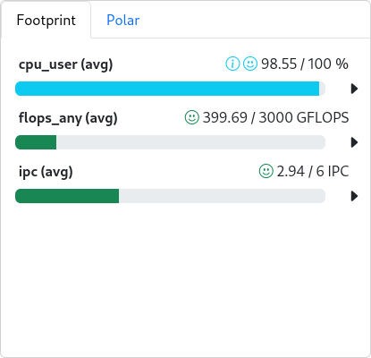
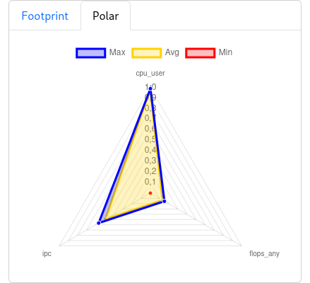

# Receive and display metrics

A new metric needs an entry in `metricConfig` in `cluster.json` as well as its collector configuration. Only then can `cc-backend` accept and display the values. The [path of a measurement](metric_flow.md) shows how the collector, router, write API, and backend work together.

The store configuration from installation is sufficient for the first measurements. The direct path covers the metric entry, restart, and verification in the node view. Display options and store retention follow below.

<a id="2-update-cc-backendclusterjson"></a>

## 1. Registering a metric in cluster.json

Path:  
`$INSTALL_DIR/cc-backend/var/job-archive/$CLUSTER_NAME/cluster.json`

`cluster.json` describes the subclusters and available metrics. Each metric has its own object in the `metricConfig` array.

### Minimal entry

```json
{
  "name": "cpu_load",
  "unit": { "base": "" },
  "scope": "node",
  "aggregation": "avg",
  "timestep": 60,
  "peak": 48,
  "normal": 48,
  "caution": 10,
  "alert": 1
}
```

**Key fields**

- `name`: The name must exactly match the published name after routing, for example after `rename_messages`.
- `unit`: Base unit and an optional prefix such as `"M"` or `"G"`. Both must match the values already scaled by `router.json`.
- `scope`: Hardware level of the measurement: `node`, `socket`, `hwthread`, `memoryDomain`, or `accelerator`.
- `aggregation`: Usually `avg` for state values and `sum` for values that can be added across hardware entities.
- `timestep`: Display interval in seconds, matching the collector’s `main.interval`.
- `peak`, `normal`, `caution`, `alert`: Reference values and display thresholds. The graph remains neutral between `normal` and `caution`, becomes yellow between `caution` and `alert`, and red below `alert`. The actual measurement and its configured thresholds determine the interpretation.

<a id="activate-the-changes"></a>

## 2. Applying changes and checking ingestion

Restarting `cc-backend` as root on the monitoring server activates the changed metric configuration:

```bash
systemctl restart clustercockpit.service
```

<a id="3-verify-incoming-metrics"></a>


After several collection intervals, node graphs for active collectors should contain values. The comparison covers the metric name, cluster, hostname, scope, and collection interval. Collector stdout must agree with the time series and displayed numbers. Missing data appears as a warning:


`Missing Metric` with `No dataset returned for …` means the named metric returned no dataset. The illustration shows `job_mem_used`; the message and name identify the problem. The diagnostic path runs from the published name in collector stdout through ingestion at `/api/write/` to the `metricConfig` entry. [Troubleshooting](faq.md) describes further checks.

### Check a completed job

A populated node time series confirms that measurements are arriving. Job attribution and archival are then covered in [A first complete job](first_job.md), once the Slurm integration is configured. That chapter includes the test procedure, expected monitoring status, restart check, and archived demo-job view.

<a id="configuration-options"></a>

## Optional display settings

### Invert the alert logic

`"lowerIsBetter": true` reverses the evaluation so that high values trigger the warning. This can be useful for `cpu_load_core`, network bandwidth.

### Show a metric only for specific subclusters

Individual subclusters can remove metrics from the shared configuration. This keeps GPU metrics limited to subclusters with GPUs:

```json
{
  "name": "acc_mem_used",
  "unit": { "base": "B", "prefix": "G" },
  "lowerIsBetter": true,
  "scope": "accelerator",
  "aggregation": "sum",
  "timestep": 60,
  "peak": 100,
  "normal": 50,
  "caution": 80,
  "alert": 90,
  "subClusters": [
    { "name": "cpu", "remove": true },
    { "name": "cpu_abs2", "remove": true },
    { "name": "fatcpu", "remove": true },
    { "name": "tcpu", "remove": true }
  ]
}
```

A removed metric appears in neither the job view nor the metric selector for the affected subcluster. The administrator’s node view instead shows `Metric disabled for subcluster` with the metric and subcluster names. The illustration shows `acc_mem_used` disabled for `cpu`:


### Different thresholds per subcluster

Subclusters with different CPUs, memory, or GPU memory can have their own thresholds. Subclusters not listed continue to use the main configuration:

```json
        {
            "name": "cpu_load",
            "unit": {
                "base": ""
            },
            "scope": "node",
            "aggregation": "avg",
            "timestep": 60,
            "peak": 48,
            "normal": 48,
            "caution": 10,
            "alert": 1,
            "subClusters": [
                {
                    "name": "fatcpu",
                    "peak": 96,
                    "normal": 96,
                    "caution": 10,
                    "alert": 1
                },
                {
                    "name": "fatgpu",
                    "peak": 96,
                    "normal": 96,
                    "caution": 10,
                    "alert": 1
                }
            ]
        },
```

### Define footprint metrics

`aggregation` combines simultaneously allocated hardware entities. For example, `sum` adds the power of several GPUs. Independently, `footprint` selects the temporal job statistic: `avg`, `min`, or `max`. One possible entry for the footprint and polar plot is `"aggregation": "sum", "footprint": "avg"`. The value `footprint: sum` is invalid and prevents a successful archive status, even if archive files have already been created.

Footprint example:



The illustration contains the following example values. They are not universal targets for jobs:

| Metric | Example mean | Displayed reference value |
|---|---|---|
| `cpu_user` | 98.55 % | 100 % |
| `flops_any` | 399.69 GFLOP/s | 3000 GFLOP/s |
| `ipc` | 2.94 Instructions/Cycle | 6 Instructions/Cycle |

Polar plot example:



The polar plot shows the maximum (`Max`), mean (`Avg`), and minimum (`Min`) of the same three metrics on normalised axes. A point near the outer edge is close to that metric’s reference value. Each axis represents a different absolute scale. The footprint and statistics view complement this overview with names, numbers, and units.

With `"lowerIsBetter": true`, a left-pointing arrow marks the reversed evaluation. This example uses only metrics with `scope: hwthread` so measurements on shared nodes can be attributed to jobs.

### Define energy footprint

Power values in Watts use `"energy": "power"`. The backend calculates energy in kWh from average node power and job duration, rounded to two decimal places: `avg(W) × numNodes × duration(s) / 3 600 000`. Here `aggregation: sum` adds simultaneously used hardware entities. It does not sum the time series. Example:

```json
{
  "name": "acc_power", "unit": {"base": "W"}, "scope": "accelerator",
  "aggregation": "sum", "footprint": "avg", "energy": "power",
  "timestep": 60, "peak": 700, "normal": 400
}
```

The schema value `energy: energy` is not implemented. It returns 0 with a warning and is therefore unsuitable for Joule counters. These require a tested conversion to power over the actual collection interval. Total node power and the CPU/GPU power already included in it must not both be marked as separate energy contributions, or consumption will be counted twice. Available measurements and job attribution need verification on the actual hardware.

CPU-only example:


In the CPU example, the contribution from `core_power` and the total energy are both **0.52 kWh**.

GPU contributions:


In the GPU example, **1.74 kWh** from `acc_power` and **0.30 kWh** from `core_power` add up to **2.04 kWh**. These illustrations explain the display; measured values depend on the actual job.

Separate memory-energy availability depends on the CPU generation, LIKWID version, and permissions. The relevant domains are those actually provided by the processor on each node. The optional `emission-constant` in `cc-backend/config.json` describes the electricity CO₂ factor in g/kWh. Together with measured energy, it gives a theoretical CO₂ emission per job for display in the web interface.

<a id="1-check-the-metric-store-in-cc-backend"></a>

## Metric store and retention

Default path (following this guide):

`$INSTALL_DIR/cc-backend/config.json`

The metric store is configured through the `metric-store` section in `cc-backend/config.json`:

```json
"metric-store": {
  "checkpoints": {
    "file-format": "json",
    "directory": "./var/checkpoints"
  },
  "memory-cap": 100,
  "retention-in-memory": "48h",
  "cleanup": {
    "mode": "archive",
    "directory": "./var/archive"
  }
}
```

**Fields**

- `retention-in-memory`: Time window for keeping metric data in memory.
- `checkpoints`: Location and format of checkpoints.
- `cleanup`: Behaviour for data outside the in-memory retention period. `archive` writes it to the configured directory; `delete` removes it. The retention period and available disk space must support this choice.

Changes to the store settings also require a restart of `cc-backend`:

```bash
systemctl restart clustercockpit.service
```


### Check retention and restarts

JSON checkpoints save current time series for a controlled restart. They round to one decimal place, for example 0.034 to 0.0. A test job provides a comparison of timestamps and rounded values before and after the restart. Delayed samples belong in this comparison as well.

The retention period should cover at least the maximum job duration. Active jobs are normally kept longer, but the memory limit and retention window loaded at restart still impose limits. Before maintenance, running jobs should finish where possible and their archived values should be checked.

## Example configurations

The [RUB example profile](example_profiles.md) contains the complete backend, UI, cluster, and collector files with explanations. These files are a site-specific reference; the [quick setup](cc_metric_collector_quicksetup.md) uses the smaller minimal profile.

<a id="cc-backendconfigjson"></a>

- [cc-backend/config.json](example_profiles.md#cc-backendconfigjson)

<a id="job-archiveclusterjson"></a>

- [job-archive/cluster.json](example_profiles.md#job-archiveclusterjson)

<a id="cc-backendui-configjson"></a>

- [cc-backend/ui-config.json](example_profiles.md#cc-backendui-configjson)

<a id="cc-metric-collectorconfigjson"></a>

- [cc-metric-collector/config.json](example_profiles.md#cc-metric-collectorconfigjson)

<a id="cc-metric-collectorrouterjson"></a>

- [cc-metric-collector/router.json](example_profiles.md#cc-metric-collectorrouterjson)

<a id="cc-metric-collectorreceiversjson"></a>

- [cc-metric-collector/receivers.json](example_profiles.md#cc-metric-collectorreceiversjson)

<a id="cc-metric-collectorsinksjson"></a>

- [cc-metric-collector/sinks.json](example_profiles.md#cc-metric-collectorsinksjson)
