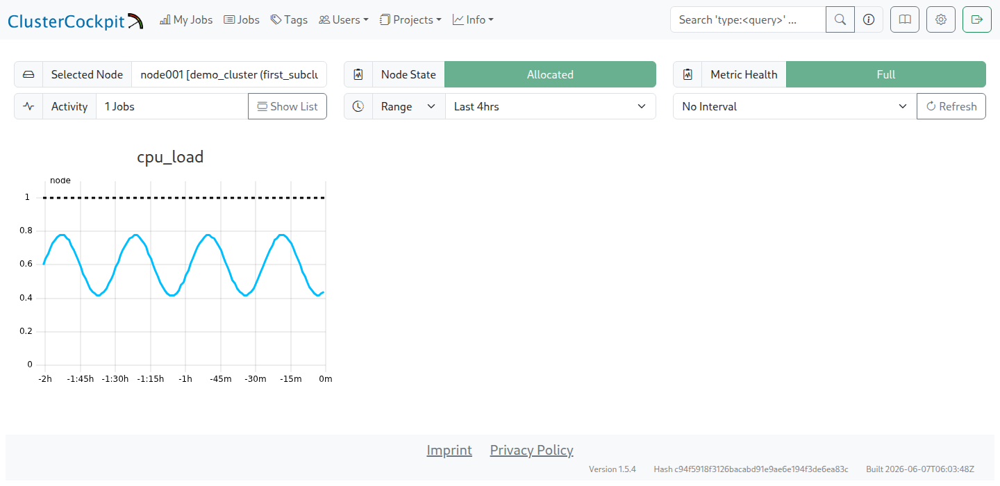

# Schritt-für-Schritt: Erste Metrik

!!! info "Erste Metrik Schritt für Schritt"
    Dieses Kapitel folgt auf die [Collectorinstallation](cc_metric_collector_setup.de.md) und erklärt den Weg von `load_one` bis zur Anzeige als `cpu_load`. Der [Schnellstart](cc_metric_collector_quicksetup.de.md) ist eine Alternative mit fertiger Konfiguration. Beide Wege enden beim [Collector als Dienst](collector_service.de.md).

Eine Metrik durchläuft drei Schritte: Der Collector erhebt sie, der Router legt Namen und Auswahl fest, und die `cluster.json` im Job-Archive beschreibt ihre Speicherung und Anzeige. Den Zusammenhang der Dateien zeigt der [Weg einer Metrik](metric_flow.de.md). Eine Übersicht über die verfügbaren Collectoren steht im [offiziellen Repository](https://github.com/ClusterCockpit/cc-metric-collector/blob/v0.8.4/collectors/README.md).

## Messwerte erheben

Der Einstieg verwendet die erforderliche Metrik `cpu_load`. Ihre Quelle ist der Collector `loadavg`, der in der minimalen `collectors.json` bereits aktiviert ist:

```json
{
  "loadavg" : {}
}
```

Der Aufruf `./cc-metric-collector -config ./config_stdout.json -once` schreibt die Messwerte ins Terminal. Mit `demo_cluster` und dem Hostnamen `node001` sieht die Ausgabe beispielsweise so aus; Werte und Zeitstempel unterscheiden sich je nach Messung:

```bash
load_one,cluster=demo_cluster,hostname=node001,type=node value=0.27 1752156889208064633
load_five,cluster=demo_cluster,hostname=node001,type=node value=0.82 1752156889208064633
load_fifteen,cluster=demo_cluster,hostname=node001,type=node value=0.94 1752156889208064633
proc_run,cluster=demo_cluster,hostname=node001,type=node value=1i 1752156889208064633
proc_total,cluster=demo_cluster,hostname=node001,type=node value=1712i 1752156889208064633
```

Jede Zeile enthält eine Nachricht im Line-Protocol-Format für die Write-API von `cc-backend`. Die erste Spalte enthält Metrikname, Clustername, Hostname und Typ. Neben `node` gibt es beispielsweise `socket`, `memoryDomain` für eine NUMA-Domain und `hwthread` für einen Hardware-Thread. Bei anderen Metriken kommen Einheiten und für feinere Auflösungen Identifikatoren hinzu. In der zweiten Spalte steht der Wert; ein angehängtes `i` kennzeichnet Ganzzahlen. Die dritte Spalte enthält den Unix-Zeitstempel in Nanosekunden.

`loadavg` liefert fünf Werte: den Load Average über eine, fünf und fünfzehn Minuten, die Anzahl laufender Prozesse und die Gesamtzahl der Prozesse. Für dieses Beispiel bleibt nur `load_one` erhalten und bekommt den Namen `cpu_load`.

## Namen und Filter festlegen

Der `messageProcessor` aus `cc-lib` übernimmt diese Verarbeitung. Die folgende vollständige `router.json` benennt `load_one` um und verwirft die übrigen Nachrichten:

```json
{
  "add_tags": [
    {
      "key": "cluster",
      "value": "__CLUSTER__",
      "if": "*"
    }
  ],
  "interval_timestamp": false,
  "num_cache_intervals": 0,
  "normalize_units": true,
  "process_messages": {
    "stage_order": ["add_tag", "rename", "rename_if", "drop_by_type", "drop_by_name", "drop_if", "add_meta", "change_unit_prefix", "normalize_unit"],
    "hostname_tag": "hostname",
    "rename_messages": {
      "load_one": "cpu_load"
    },
    "drop_messages_if": [
      "!(name in ['cpu_load'])"
    ]
  }
}
```

Die Liste in `drop_messages_if` wirkt als Positivliste. Die explizite `stage_order` führt `rename` vor `drop_if` aus; diese Reihenfolge muss auch bei späteren Erweiterungen erhalten bleiben. Filter und Einheitenumrechnungen beziehen sich dadurch auf die umbenannten Metriken, hier also `cpu_load`.

Nach dem Ersetzen der Routerdatei muss die konfigurierte Identität erneut gesetzt werden. `__CLUSTER__` ist ein Platzhalter. Die folgenden Befehle laufen als root im Collectorverzeichnis und verwenden dieselben Cluster- und HTTPS-Werte sowie dieselbe geschützte Tokendatei wie im Setup. Das Hilfsskript steht als [configure-collector.py](scripts/configure-collector.py) bereit.

```bash
python3 "$GUIDE_DIR/docs/scripts/configure-collector.py" \
  --directory "$COLLECTOR_DIR" --cluster demo_cluster \
  --url 'https://monitoring.example.org/api/write/?cluster=demo_cluster' \
  --token-file "$TOKEN_FILE"
cd "$COLLECTOR_DIR"
./cc-metric-collector -config ./config_stdout.json -once
```

Die Ausgabe sollte jetzt nur `cpu_load` mit dem erwarteten Cluster und Hostnamen enthalten:

```bash
cpu_load,cluster=demo_cluster,hostname=node001,type=node value=1.58 1752158115922836909
```

Einheitenumrechnungen sind für den dimensionslosen Load Average nicht erforderlich. Die Umrechnung von Speicherwerten in GB sowie die Bedeutung von `change_unit_prefix` beschreibt [Einheiten und Validierung](units.de.md); weitere konkrete Regeln stehen unter [Weitere Metriken](more_metrics.de.md).

## Backenddefinition prüfen

Im Job-Archive liegt die Datei `cc-backend/var/job-archive/$CLUSTER_NAME/cluster.json`. Die Installation hat dort unter `metricConfig` bereits einen Eintrag für `cpu_load` angelegt. Diesen Eintrag prüfen und bei Bedarf anpassen, **keinen zweiten Eintrag mit demselben Namen ergänzen**. Die unveränderte Installervorlage enthält:

```json
{
  "name": "cpu_load",
  "unit": {
    "base": ""
  },
  "scope": "node",
  "aggregation": "avg",
  "footprint": "avg",
  "timestep": 60,
  "peak": 1,
  "normal": 1,
  "caution": 1,
  "alert": 1
}
```

Die leere Basiseinheit bezeichnet den dimensionslosen Load Average; die Werte sind keine Prozentangaben. `peak`, `normal`, `caution` und `alert` sind Beispielgrenzen der Ein-Thread-Demo. Sie müssen zu Hardware und gewünschter Bewertung passen; eine angepasste Clusterdefinition darf beim Vergleich nicht wieder durch diese Demowerte ersetzt werden.

`timestep` muss zum `main.interval` des Collectors passen, hier 60 Sekunden. `avg` eignet sich für Zustands- oder Intensitätswerte pro Einheit, etwa Frequenz, CPU-/GPU-Auslastung und Temperatur. `sum` ist für addierbare Werte wie FLOPS oder Energieverbräuche vorgesehen. Das Beispiel verwendet `avg` und nimmt den Mittelwert in den Footprint auf.

Änderungen an der Backenddefinition werden wie unter [Metriken empfangen und anzeigen](metric_receive_display.de.md#anderungen-aktivieren) aktiviert. Vor der Übertragung müssen der [HTTPS-Endpunkt und die API-Freigabe](https_setup.de.md) eingerichtet sein. `./cc-metric-collector -config ./config.json -once` sendet anschließend eine Messung über den konfigurierten HTTP-Sink mit dem geschützten JWT.

## Erwartetes Ergebnis im Webinterface

Für eine gefüllte Zeitreihe braucht der Collector mehrere Messintervalle. Dazu folgt jetzt [Collector als Dienst betreiben](collector_service.de.md). Ein einzelner erfolgreicher `-once`-Aufruf prüft die Übertragung, erzeugt aber noch keine fortlaufende Kurve.

Über `Info → Nodes → demo_cluster → Node List` den Knoten `node001` öffnen und `cpu_load` auf Node-Ebene auswählen. Die folgende Demoaufnahme zeigt den Weg zur Node-Ansicht und die zugehörige Zeitreihe:



Die Demoaufnahme enthält bereits einen vom Scheduler gemeldeten `Node State`. Vor der Slurm-Anbindung kann dieser noch fehlen; für die erste Metrik zählen die Knotenzuordnung und die Zeitreihe.

Der [vergrößerte Kurvenausschnitt](img/first_metric.png) zeigt künstliche Werte zwischen ungefähr 0,42 und 0,78. Entscheidend sind der richtige Metrikname, die Zuordnung zum erwarteten Knoten und eine gefüllte Zeitreihe. Die tatsächlichen Cluster- und Hostnamen können vom Beispiel abweichen; der Kurvenverlauf hängt von der Last ab.

Nach der Node-Prüfung folgen die [Slurm-Anbindung](slurm_setup.de.md) und ein [vollständiger Testjob](first_job.de.md). [Weitere Metriken und Schwellenwerte](more_metrics.de.md) ergänzen den funktionierenden Grundaufbau nach Bedarf.
