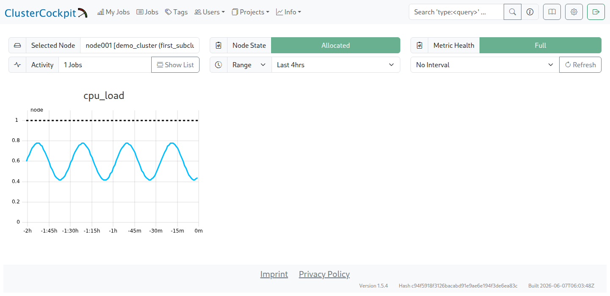

# Step-by-step: first metric

!!! info "First metric walkthrough"
    This chapter follows the [collector installation](cc_metric_collector_setup.md) and explains the route from `load_one` to its display as `cpu_load`. The [quick setup](cc_metric_collector_quicksetup.md) is an alternative using a complete configuration. Both routes finish with [running the collector as a service](collector_service.md).

A metric passes through three stages: the collector measures it, the router sets its name and selection rules, and `cluster.json` in the job archive describes its storage and display. The [metric data flow](metric_flow.md) shows how the files fit together. The [upstream repository](https://github.com/ClusterCockpit/cc-metric-collector/blob/v0.8.4/collectors/README.md) lists the available collectors.

## Collecting measurements

The starting point is the required metric `cpu_load`. Its source is `loadavg`, which is already enabled in the minimal `collectors.json`:

```json
{
  "loadavg" : {}
}
```

The command `./cc-metric-collector -config ./config_stdout.json -once` writes measurements to the terminal. With `demo_cluster` and hostname `node001`, the output resembles the following example; values and timestamps vary with each measurement:

```bash
load_one,cluster=demo_cluster,hostname=node001,type=node value=0.27 1752156889208064633
load_five,cluster=demo_cluster,hostname=node001,type=node value=0.82 1752156889208064633
load_fifteen,cluster=demo_cluster,hostname=node001,type=node value=0.94 1752156889208064633
proc_run,cluster=demo_cluster,hostname=node001,type=node value=1i 1752156889208064633
proc_total,cluster=demo_cluster,hostname=node001,type=node value=1712i 1752156889208064633
```

Each line contains a message in line protocol for the `cc-backend` write API. The first column contains the metric name, cluster name, hostname, and type. Alongside `node`, types include `socket`, `memoryDomain` for a NUMA domain, and `hwthread` for a hardware thread. Other metrics add units and identifiers for finer granularity. The second column holds the value, with a trailing `i` denoting an integer. The third column is the Unix timestamp in nanoseconds.

`loadavg` reports five values: the one-, five-, and fifteen-minute load averages, the number of running processes, and the total process count. This example keeps only `load_one` and renames it to `cpu_load`.

## Names and filters

The `messageProcessor` from `cc-lib` handles this processing. The following complete `router.json` renames `load_one` and drops the other messages:

```json
{
  "add_tags": [
    {
      "key": "cluster",
      "value": "__CLUSTER__",
      "if": "*"
    }
  ],
  "interval_timestamp": false,
  "num_cache_intervals": 0,
  "normalize_units": true,
  "process_messages": {
    "stage_order": ["add_tag", "rename", "rename_if", "drop_by_type", "drop_by_name", "drop_if", "add_meta", "change_unit_prefix", "normalize_unit"],
    "hostname_tag": "hostname",
    "rename_messages": {
      "load_one": "cpu_load"
    },
    "drop_messages_if": [
      "!(name in ['cpu_load'])"
    ]
  }
}
```

The `drop_messages_if` list acts as an allowlist. The explicit `stage_order` runs `rename` before `drop_if`; later extensions must preserve this order. Filters and unit conversions therefore use the renamed metric, which is `cpu_load` here.

Replacing the router file requires the configured identity to be applied again. `__CLUSTER__` is a placeholder. The following commands run as root in the collector directory, using the same cluster and HTTPS settings and protected token file as the setup. The helper is available as [configure-collector.py](scripts/configure-collector.py).

```bash
python3 "$GUIDE_DIR/docs/scripts/configure-collector.py" \
  --directory "$COLLECTOR_DIR" --cluster demo_cluster \
  --url 'https://monitoring.example.org/api/write/?cluster=demo_cluster' \
  --token-file "$TOKEN_FILE"
cd "$COLLECTOR_DIR"
./cc-metric-collector -config ./config_stdout.json -once
```

The output should now contain only `cpu_load`, with the expected cluster and hostname:

```bash
cpu_load,cluster=demo_cluster,hostname=node001,type=node value=1.58 1752158115922836909
```

The dimensionless load average needs no unit conversion. [Units and validation](units.md) explains memory conversions to GB and the role of `change_unit_prefix`; [Additional metrics](more_metrics.md) contains further examples.

## Backend definition

The job archive contains `cc-backend/var/job-archive/$CLUSTER_NAME/cluster.json`. Installation has already added a `cpu_load` entry under `metricConfig`. That entry needs checking and, where necessary, adjustment; **a second entry with the same name must not be added**. The unmodified installation template contains:

```json
{
  "name": "cpu_load",
  "unit": {
    "base": ""
  },
  "scope": "node",
  "aggregation": "avg",
  "footprint": "avg",
  "timestep": 60,
  "peak": 1,
  "normal": 1,
  "caution": 1,
  "alert": 1
}
```

The empty base unit denotes the dimensionless load average, not a percentage. `peak`, `normal`, `caution`, and `alert` are example limits for the single-thread demo. They must suit the hardware and intended assessment; a cluster definition already adapted to the site must not be replaced with these demo limits during comparison.

`timestep` must match the collector's `main.interval`, which is 60 seconds here. `avg` suits state or intensity metrics per entity, such as frequency, CPU/GPU utilisation, and temperature. `sum` suits additive measurements such as FLOPS or energy consumption. This example uses `avg` and includes the average in the footprint.

Changes to the backend definition take effect as described under [Metric reception and display](metric_receive_display.md#activate-the-changes). Before transmission, the [HTTPS endpoint and API access](https_setup.md) must be configured. The command `./cc-metric-collector -config ./config.json -once` then sends one measurement through the configured HTTP sink with the protected JWT.

## Expected result in the web interface

A populated time series requires several collection intervals. The next step is therefore [running the collector as a service](collector_service.md). A successful `-once` call checks transmission but does not produce a continuous curve.

The node view is available through `Info → Nodes → demo_cluster → Node List`, then `node001`, with `cpu_load` selected at node level. The following demo screenshot shows the navigation and the corresponding time series:



The demo screenshot already includes a scheduler-reported `Node State`. This may be absent before Slurm integration; the first metric check concerns the node assignment and the time series.

The [enlarged plot](img/first_metric.png) contains synthetic values between approximately 0.42 and 0.78. The checks are the metric name, assignment to the expected node, and a populated time series. Actual cluster and host names can differ from the example, and the curve depends on the workload.

After the node check, the next steps are [Slurm integration](slurm_setup.md) and a [complete test job](first_job.md). [Additional metrics and thresholds](more_metrics.md) extend the working setup as needed.
