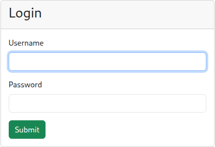
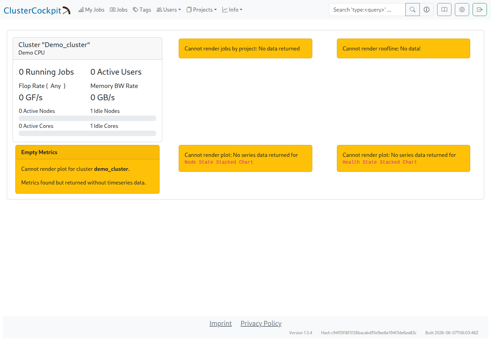

# Webinterface

## Erster Login

Nach dem Start von `cc-backend` ist die Weboberfläche während der Installation unter `http://<Monitoring-Server>:8080` erreichbar. Nach der HTTPS-Einrichtung gilt die konfigurierte Serveradresse.

Die Installation hat den Benutzer `admin` angelegt. Sein Passwort steht in `admin_password.txt` unter `$INSTALL_DIR/cc-backend/`. Die Weboberfläche bietet keine Funktion zum Ändern des Passworts; das unterstützte Verfahren beschreibt [Lokale Konten und Passwortpflege](user_accounts.de.md#passwort-andern).

Die Aufnahmen zeigen eine lokale Demo mit künstlichen Daten. Die Cluster- und Knotennamen der tatsächlichen Installation können davon abweichen.

## Übersicht: Webinterface nach Erst-Login

Nach dem Login erscheint die Navigationsleiste oben. Unter `Info → Status → demo_cluster → Status Dashboard` steht der Beispielcluster zur Verfügung, sofern seine `cluster.json` vorhanden und gültig ist.

`demo_cluster` und der eine `Idle Node` bestätigen nach einer frischen Installation, dass das Backend die Clusterdefinition und Knotentopologie geladen hat. Zu diesem Zeitpunkt fehlen noch Collectormesswerte und Jobdaten. Leere Auslastungsanzeigen sowie `Empty Metrics` und `Cannot render roofline: No data!` sind deshalb erwartbar und weisen zunächst nur auf fehlende Diagrammdaten hin.

Die Datei `cluster.json` muss am richtigen Ort liegen und gültiges JSON enthalten. Der Clustername muss mit ihrem Feld `name` im Job-Archive übereinstimmen. Der nächste Schritt ersetzt die Demokonfiguration durch eine [passende Cluster- und Knotenzuordnung](cluster_minimal.de.md).

## Typische Probleme und Hinweise

- **Die Navigationsleiste fehlt:** Eine fehlende oder fehlerhafte `cluster.json` kann das Laden der Oberfläche verhindern. Die [FAQ](faq.de.md) beschreibt die Prüfung der Konfigurationsdateien.
- **Der Dienst ist nicht erreichbar:** Dienststatus, Journal, Firewall und Routing prüfen. Während der Installation ist Port `8080` relevant, nach der HTTPS-Einrichtung Port `443`.

Ein erfolgreicher Login mit sichtbarem Cluster schließt diesen Kontrollpunkt ab. Die eigentliche Datenübertragung folgt nach [Clusterkonfiguration](cluster_minimal.de.md) und [Collectorinstallation](cc_metric_collector_setup.de.md).
