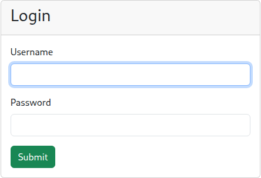
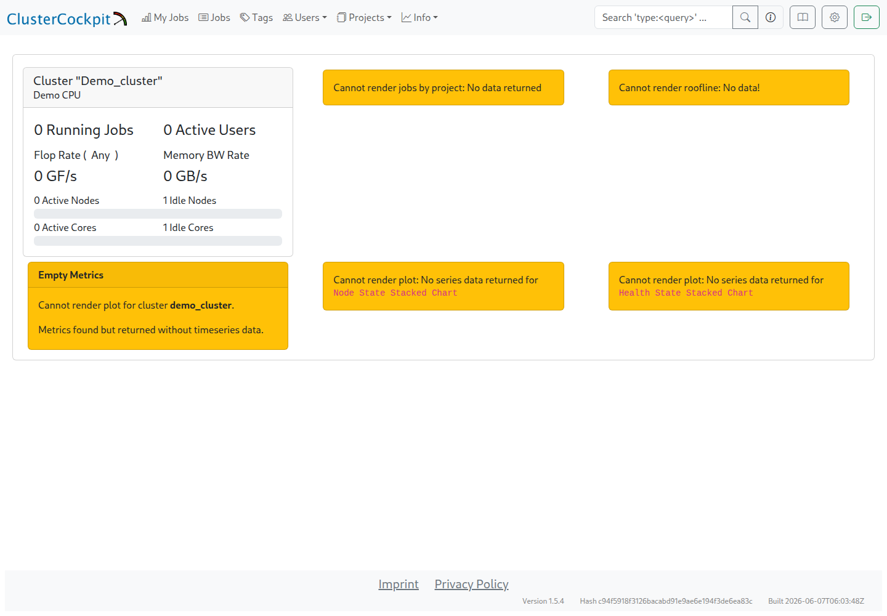

# Web interface

## First login

After `cc-backend` starts, the web interface is available during installation at `http://<monitoring-server>:8080`. Once HTTPS is configured, the configured server address applies.

Installation created the `admin` account. Its password is stored in `admin_password.txt` under `$INSTALL_DIR/cc-backend/`. The web interface has no password-change function; [Local accounts and passwords](user_accounts.md#change-a-password) describes the supported procedure.

These screenshots show a local demo with synthetic data. Actual cluster and node names can differ from the examples.

## Overview: web interface after first login

After login, the navigation bar appears at the top. The example cluster is available under `Info → Status → demo_cluster → Status Dashboard`, provided its `cluster.json` exists and is valid.

After a fresh installation, `demo_cluster` and the single `Idle Node` confirm that the backend has loaded the cluster definition and node topology. Collector measurements and job data have not arrived yet. Empty utilisation indicators, `Empty Metrics`, and `Cannot render roofline: No data!` are therefore expected at this stage and initially indicate only that the charts lack data.

The `cluster.json` file must be in the correct location and contain valid JSON. The cluster name must match its `name` field in the job archive. The next step replaces the demo configuration with a [matching cluster and node definition](cluster_minimal.md).

## Typical issues and hints

- **Missing navigation bar:** A missing or invalid `cluster.json` can prevent the interface from loading. The [FAQ](faq.md) covers configuration checks.
- **Service unavailable:** The service status, journal, firewall, and routing provide the first checks. Port `8080` applies during installation, and port `443` after HTTPS setup.

A successful login with a visible cluster completes this checkpoint. Data transmission follows the [cluster configuration](cluster_minimal.md) and [collector installation](cc_metric_collector_setup.md).
